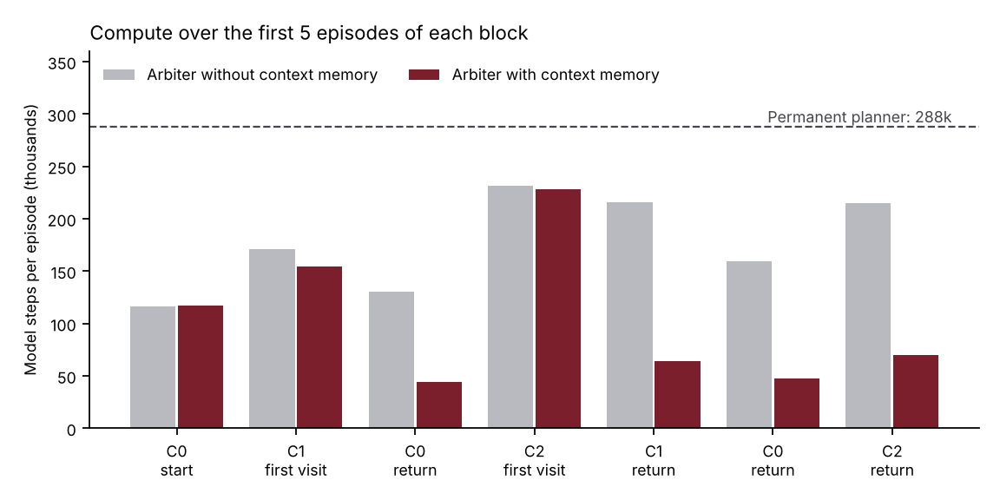

# Toy testbed

First test of the building blocks, on a deliberately simple setting. It produces the preliminary numbers quoted in the proposal.

## Setup

A 2D point robot must reach a goal in 50 steps. Three hidden contexts alternate by blocks of 20 episodes, in the order C0, C1, C0, C2, C1, C0, C2:

- **C0:** nominal.
- **C1:** mass doubled, motors rotated by 90°.
- **C2:** more friction, wind, commands rotated by −120°.

Building blocks: Bayesian linear world model, CEM planner (horizon 15, 128 samples, 3 iterations, so 5,760 model steps per planned decision), linear habit distilled from the planner, arbiter driven by world-model surprise and by the predicted cost gap between habit and plan. The agent with context memory creates a new context when unexplained surprise persists, and recognises a known context by its prediction error.

Computation is counted in model steps per episode, spot checks included.

## Results

Means over 5 seeds of 140 episodes. "After a change" covers the first 5 episodes of each block after the first.

| Agent | Success | Success after a change | Compute per episode |
|---|---|---|---|
| Permanent planner | 96.9% | 85.3% | 288k |
| Habit frozen after first block | 42.9% | 33.3% | 6k |
| Arbiter without context memory | 100.0% | 100.0% | 63k |
| **Arbiter with context memory** | **99.7%** | **98.7%** | **50k** |

- The arbiter with context memory uses 5.8 times less computation than the permanent planner.
- At the start of a return to a known context, it spends 3.2 times less than the arbiter without memory (57k against 180k model steps per episode over the first 5 episodes).
- It finds exactly 3 contexts in all 5 seeds.



## Limits

- The dynamics are linear and the world model is linear and well specified. A deep world model on a real robot is the actual challenge.
- The thresholds of the arbiter and of context inference are hand-tuned.
- The contexts are well separated, which favours the memory.
- The lower success of the permanent planner after a change comes from its adaptive estimator, which is too confident after a long stable period. It is not an advantage of arbitration.
- On a first visit the memory does not help. Over the whole first C2 block, the agent with memory spends more (115k against 71k per episode).
- Training cost is not counted.

## Reproduce

Requires Python 3 and numpy (matplotlib for the figure). About one minute on a laptop CPU.

```bash
cd experiments/toy_testbed
python ../../src/testbed/sim.py 5
python ../../src/testbed/summarize.py results.json compute_by_block.png
```

`results.json` in this folder is the output of that run.
